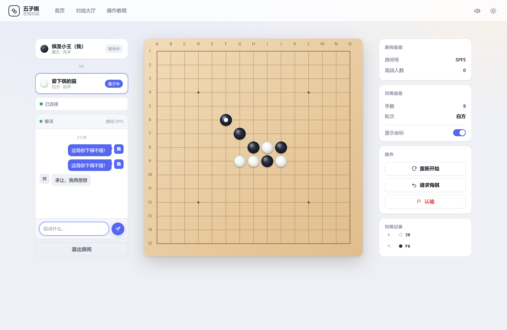
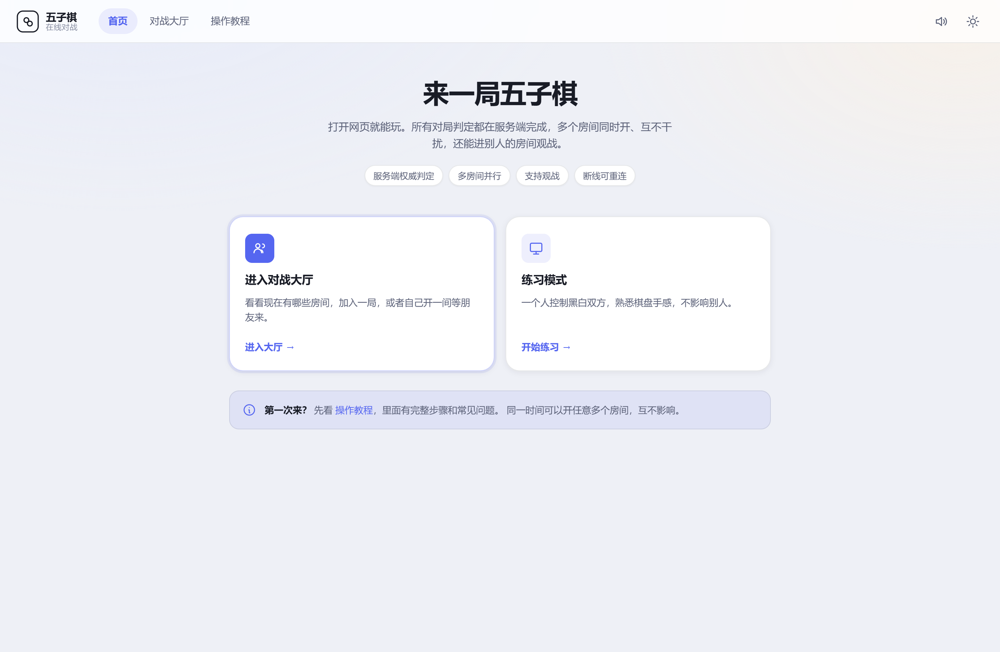
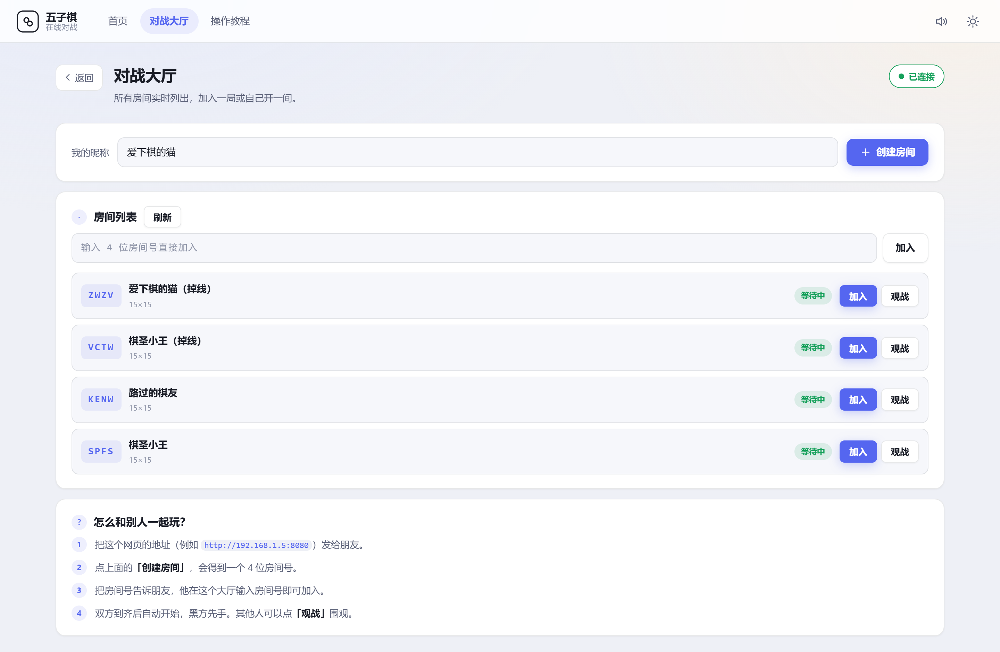
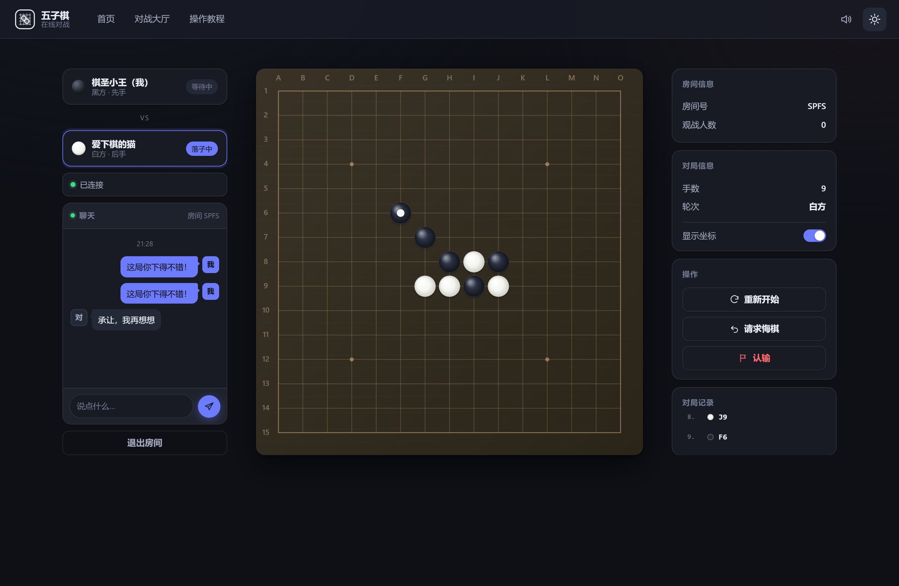
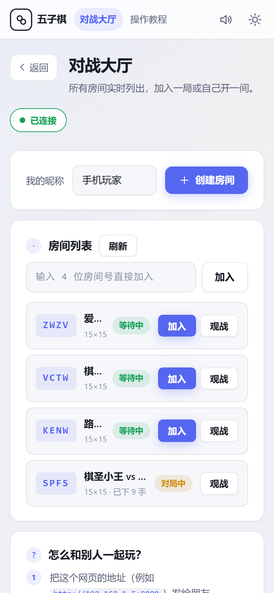

# 五子棋 · 在线对战

**服务端权威**的五子棋对战系统。所有对局逻辑都在服务端运行，客户端只负责显示与上报操作 —— 因此它**无法作弊，也不可能和服务端算出不一样的结果**。

[](https://github.com/Litt1-div/gomoku-online/actions/workflows/ci.yml)
[](LICENSE)
[](https://www.python.org/)
[](#零依赖)

> 服务端只用 Python 标准库，**不需要 `pip install` 任何东西**。双击一个 `.bat` 就能跑起来。



<details>
<summary>更多截图</summary>

| 首页 | 对战大厅 |
|---|---|
|  |  |

| 暗色主题 | 移动端 |
|---|---|
|  |  |

</details>

---

## 为什么做这个

很多「网页五子棋」把胜负判定放在前端 —— 两端各算一遍。这带来三个绕不开的问题：

| 问题 | 后果 |
|---|---|
| 两端各算一遍 | 逻辑稍有出入就不同步，且极难排查 |
| 判定在前端 | 改几行 JS 就能作弊 |
| 一对一连接 | 无法支持多人并行与观战 |

这个项目把**判定权完全交给服务端**：

- 客户端 `js/` 目录下**没有一行胜负判定或落子校验**，它只会「把点击发上去」和「把收到的画出来」
- 服务端对每个操作独立校验：越界、已占、非本方回合、非法类型，一律拒绝
- 每个房间持有独立棋局，可同时开任意多局，还支持旁观

> 门禁里有专门的**架构不变量检查**来守住这条线 —— 如果不小心在客户端写了 `checkWin`，提交时会直接报错。

---

## 特性

**对局**
- 15 × 15 标准棋盘，星位与坐标标注（可开关）
- 横 / 竖 / 斜任意方向先连成五子者胜，支持和棋
- 长连（六子及以上）自动截取最靠落子点的五子用于高亮
- 落子悬停预览、最后一手标记、获胜连线高亮
- 高清屏适配，窗口缩放自适应

**联机**
- WebSocket 长连接，服务端主动推送状态
- 房间列表实时更新，可创建 / 加入 / 观战
- **多房间并行**，互不干扰
- **断线自动重连**：席位保留 3 分钟，刷新页面棋局不丢
- 服务端严格校验所有操作，客户端无法作弊

**对局交互**
- 重新开始 / 悔棋 / 认输，均为「请求 → 对方同意」的双向确认
- 微信风格聊天面板（气泡、头像、时间分隔）
- 对局记录面板，实时滚动
- Web Audio 实时合成音效，零音频文件
- 明 / 暗双主题

---

## 快速开始

### 1. 启动服务端

```bash
git clone https://github.com/Litt1-div/gomoku-online.git
cd gomoku-online

python server/server.py            # 默认 8080 端口
python server/server.py --open     # 启动后自动打开浏览器
```

Windows 用户可以直接双击 **`start-server.bat`**。

> 需要 Python 3.7+。没有其他依赖。

启动后会打印访问地址：

```
======================================================
  五子棋 · 服务端已启动（所有对局逻辑在本机运行）
======================================================

  本机访问：   http://127.0.0.1:8080
  局域网访问： http://192.168.1.5:8080
```

### 2. 把地址发给朋友

**把这个「局域网访问」地址发出去**，大家用浏览器打开即可。所有人需要连同一个 Wi-Fi。

### 3. 开一局

1. 点顶部导航的**「对战大厅」**
2. 填个昵称，点**「创建房间」**，拿到一个 4 位房间号
3. 把房间号告诉朋友，他在大厅输入后点「加入」
4. 人齐自动开始，房主执黑先手
5. 其他人可以点**「观战」**围观

想自己先试试？点首页的**「练习模式」**，一个人控制黑白双方。

### 命令行参数

```bash
python server/server.py                  # 默认 8080
python server/server.py 9000             # 指定端口
python server/server.py 9000 127.0.0.1   # 只监听本机（自测用）
python server/server.py --open           # 启动后自动打开浏览器
python server/server.py --help           # 查看帮助
```

---

## 工作原理

```
   浏览器 A ──┐                       ┌────────────────────────────────────┐
   浏览器 B ──┤  HTTP  → 静态页面      │            server.py               │
   浏览器 C ──┤  WS    → JSON 消息     │  ┌──────────────────────────────┐  │
   浏览器 D ──┘                       │  │  HTTP 静态托管 + WS 升级      │  │
                                      │  ├──────────────────────────────┤  │
                                      │  │  会话层  Session             │  │
                                      │  │   · 连接 / 昵称 / 断线重连    │  │
                                      │  ├──────────────────────────────┤  │
                                      │  │  房间层  RoomManager         │  │
                                      │  │   ├ Room ABCD → GomokuGame   │  │
                                      │  │   ├ Room EFGH → GomokuGame   │  │
                                      │  │   └ Room IJKL → GomokuGame   │  │
                                      │  └──────────────────────────────┘  │
                                      └────────────────────────────────────┘
                                             唯一权威状态源
```

**职责边界划得很清楚：**

| 由服务端负责 | 由客户端负责 |
|---|---|
| 落子是否合法（越界 / 已占 / 非本方回合） | 把点击变成一条 `move` 消息发上去 |
| 是否连成五子、谁赢了 | 把收到的棋盘画出来 |
| 悔棋、重开、认输的规则 | 弹确认框、显示结果 |
| 房间生命周期、席位管理 | 房间列表的展示 |

### 通信方式

**WebSocket + JSON 文本帧**。协议实现只用 Python 标准库手写（RFC 6455），不引入任何依赖。

| 方向 | 消息 |
|---|---|
| C→S | `hello` `list` `create` `join` `spectate` `practice` `move` `restart` `undo` `respond` `surrender` `chat` `leave` |
| S→C | `welcome` `rooms` `room` `state` `request` `chat` `peer` `info` `error` |

### 关键设计：每次变化都广播完整快照

服务端在任何状态变化后，向房间内所有人广播一份**完整的棋局快照**：

```json
{"t":"state","state":{
  "room":"ABCD","status":"playing","practice":false,
  "players":[{"color":1,"name":"张三","connected":true},
             {"color":2,"name":"李四","connected":true}],
  "spectators":1,"pending":null,
  "game":{"size":15,"board":[0,0,1,"..."],"turn":1,"winner":0,
          "ended":false,"winLine":null,"moves":[[7,7,1]],"moveCount":1}
}}
```

15×15 棋盘快照约 600 字节，一局最多 225 手，这点带宽完全负担得起。
换来的是：**不需要增量同步、不需要版本号、不需要冲突合并** —— 客户端每次被完整覆盖一次，天然一致。

---

## 多对局隔离与状态管理

| 机制 | 做法 |
|---|---|
| **对局隔离** | 每个 `Room` 持有独立的 `GomokuGame` 实例，房间之间不共享任何可变状态 |
| **注册表并发** | `RoomManager` 用一把全局锁保护「房间字典 + 会话字典」 |
| **房间内并发** | 每个 `Room` 自己一把锁，所有改动棋局的操作都收敛到 `apply_move` / `do_undo` / `do_reset` |
| **锁顺序** | 永远是「管理器 → 房间」，绝不反向，避免死锁 |
| **广播不阻塞** | 先在锁内取出目标会话列表，出锁后再发 —— 慢客户端不会拖住整个房间 |
| **连接写入** | 每条 WebSocket 自带发送锁，避免多房间线程交叉写帧 |
| **席位绑定** | 一个连接同一时刻只属于一个房间 |
| **断线重连** | 会话身份与连接分离：断开只标记离线、保留席位，3 分钟内重连即可回到原位 |
| **生命周期** | 房间无人后回收；掉线超时的会话自动注销；后台每 30 秒清理一次 |
| **房间码** | 4 位大写字母，剔除 `I` `O` 等易混字符 |
| **落子限流** | 每个会话 50ms 最小落子间隔，静默丢弃连点 |

---

## 项目结构

```
gomoku-online/
├── index.html              页面骨架（4 个视图）
├── start-server.bat        双击启动服务端（Windows）
├── preflight.bat           双击运行提交前检查（Windows）
├── server/                 服务端（Python，零依赖）
│   ├── server.py           入口：HTTP 静态托管 + WS 升级 + 消息路由
│   ├── ws.py               极简 WebSocket 实现（RFC 6455）
│   ├── gomoku.py           权威棋局逻辑（纯数据层）
│   ├── rooms.py            房间管理器：多对局隔离与生命周期
│   └── protocol.py         消息类型常量
├── js/                     客户端（浏览器）
│   ├── config.js           配置与消息常量
│   ├── utils.js            DOM 助手 / 剪贴板 / 音效 / Toast / 弹窗
│   ├── board.js            棋盘视图模型（**不含任何规则**）
│   ├── renderer.js         Canvas 渲染与点击坐标换算
│   ├── net.js              WebSocket 客户端 + 自动重连
│   ├── views.js            视图路由
│   ├── chat.js             聊天面板        ┐
│   ├── lobby.js            对战大厅        ├ 混入 App 的模块
│   ├── gameview.js         对局界面渲染    ┘
│   └── app.js              主控制器：发意图 + 应用权威状态
├── styles/                 theme / layout / components
├── tools/preflight.py      提交前自动化门禁（8 类检查）
├── tests/                  单元测试 + 端到端测试
└── docs/                   规范与流程文档
```

---

## 开发

### 跑测试

```bash
# 服务端棋局规则单元测试（零依赖，33 项）
python tests/test_gomoku.py

# 浏览器端到端测试（需要 Playwright）
npm install
npx playwright install chromium
node tests/e2e.mjs
```

端到端测试会**自己启动服务端、跑完、再关掉**，不需要手动准备环境。

### 提交前门禁

```bash
python tools/preflight.py      # 或双击 preflight.bat
```

八类检查：语法、协议常量同步、禁用模式、DOM 引用完整性、**架构不变量**、零依赖、文件规模、未引用文件。

```
==============================================================
  提交前自动化门禁
==============================================================

  全部检查通过，没有发现问题。

==============================================================
  检查 8 项  |  ERROR 0  |  WARN 0  |  通过
==============================================================
```

**ERROR 必须为 0**，否则 CI 不会通过。

---

## 文档

| 文档 | 内容 |
|---|---|
| [`docs/CODE_REVIEW.md`](docs/CODE_REVIEW.md) | 代码审查标准与流程：四层防线、P0–P3 分级、合入门禁、时效约定、度量改进 |
| [`docs/CODE_STYLE.md`](docs/CODE_STYLE.md) | 代码规范：命名、分层、注释、JS / CSS / Python 规范 |
| [`docs/REVIEW_CHECKLIST.md`](docs/REVIEW_CHECKLIST.md) | 59 项逐项自查清单 |
| [`CONTRIBUTING.md`](CONTRIBUTING.md) | 如何搭环境、改代码、提 PR |
| [`CHANGELOG.md`](CHANGELOG.md) | 版本历史 |
| [`SECURITY.md`](SECURITY.md) | 安全设计、已知局限、公网部署须知 |

---

## 贡献

欢迎提交缺陷修复、文档改进、测试补充。

**动手前请先读 [`CONTRIBUTING.md`](CONTRIBUTING.md)** —— 里面写清了提交前必须跑的三步检查。

几个约定：

- 改动控制在 **400 行以内**，超出请拆成多个 PR
- 涉及消息协议时，`js/config.js` 与 `server/protocol.py` 必须同步修改
- **不要在客户端引入棋局规则**（门禁会拦）
- 新功能请先开 Issue 讨论，避免白做

---

## 已知限制

- 服务端进程若崩溃，所有对局中断（权威状态只存在服务端，不持久化）
- 未做高并发压测，只验证到个位数房间 / 会话
- 按局域网互信场景设计，未做对抗性安全测试 —— 公网部署前请读 [`SECURITY.md`](SECURITY.md)
- 未做无障碍审计（键盘导航、读屏软件）

---

## 许可证

[MIT](LICENSE)
